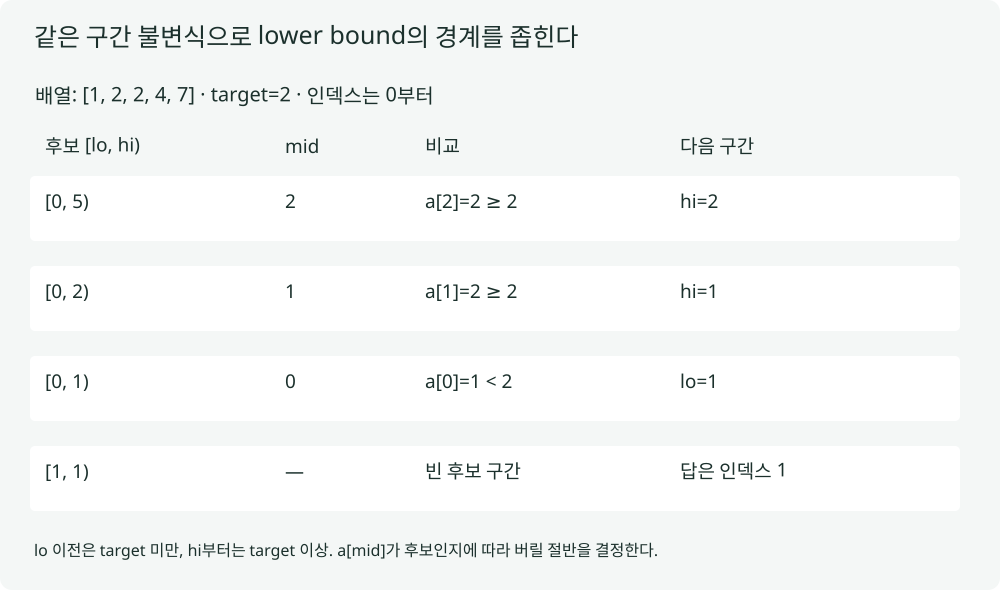

# 이진 탐색과 경계 조건

## 정의

이진 탐색은 정렬이나 단조 조건을 이용해 답이 있을 구간을 절반씩 줄이는 방법입니다. 정확한 값뿐 아니라 조건을 처음 만족하는 경계를 찾을 때도 사용합니다.

## 설명

lower bound는 target 이상인 첫 위치를 찾습니다. 후보를 반열린 구간 [lo, hi)로 두고 왼쪽 바깥은 target보다 작고 오른쪽 바깥은 target 이상이라는 조건을 유지합니다. a[mid]가 작으면 lo=mid+1, 아니면 hi=mid로 옮겨 구간을 줄입니다. 그림의 중복 2 가운데 첫 위치로 두 경계가 모이는 과정을 보세요.

끝나면 lo가 답이고 모든 값이 작다면 배열 길이 n이 나올 수 있습니다. 결과가 n인지 확인하지 않고 배열을 읽으면 안 됩니다. 비음수 인덱스에서 mid는 lo+(hi-lo)/2처럼 합 오버플로를 피합니다.

배열은 임의 접근이 빨라 O(log n) 비교와 O(1) 보조 공간을 사용할 수 있습니다. 연결 리스트의 인덱스 접근 비용을 무시하면 안 되며 Arrays.binarySearch가 중복 중 첫 위치까지 보장하는 것도 아닙니다.



## 적용 예시

빈 배열·중복·범위 밖 값을 선형 정답과 비교하는 lower bound 구현입니다. 입력이 오름차순이라는 전제와 반환값의 의미를 확인합니다.

```java
import java.util.*;
public class BinarySearchDemo {
  static int lower(int[] a,int x){
    int lo=0,hi=a.length;
    while(lo<hi){int mid=lo+(hi-lo)/2;if(a[mid]<x)lo=mid+1;else hi=mid;}
    return lo;
  }
  public static void main(String[] args){
    Random r=new Random(7);
    for(int n=0;n<80;n++){
      int[] a=r.ints(n,-10,11).sorted().toArray();
      for(int x=-12;x<=12;x++){
        int expected=0;while(expected<n&&a[expected]<x)expected++;
        assert lower(a,x)==expected;
      }
    }
  }
}
```

JDK 17에서 빈 배열·중복·최솟값보다 작은 값·최댓값보다 큰 값을 포함해 선형 정답과 비교합니다. 입력은 오름차순 int 배열로 한정합니다.

## 정리

이진 탐색은 단조한 조건에서 버려도 되는 후보를 줄입니다. 경계와 구간 불변식을 정해야 중복과 빈 입력도 일관되게 처리할 수 있습니다. 반환 위치가 배열 밖의 삽입 지점일 수 있다는 계약도 중요합니다. 정렬과 비교 기준, 오버플로 조건까지 확인해야 정확하게 적용할 수 있습니다.

## 꼬리 질문

### Q1. 정렬되지 않은 배열에서 몇 번 맞았으면 그대로 사용해도 될까요?

우연한 성공은 단조 조건의 근거가 아닙니다. 정렬 또는 판정식의 단조성이 유지되는지 먼저 확인해야 합니다.

### Q2. lower bound가 n을 반환하면 왜 바로 a[n]을 읽으면 안 될까요?

모든 원소가 target보다 작아 유효한 원소 위치가 없다는 뜻일 수 있습니다. n은 삽입 위치로는 합법적이지만 배열 원소 인덱스는 아닙니다.

---

**참고 자료**

- [Java 17 Arrays](https://docs.oracle.com/en/java/javase/17/docs/api/java.base/java/util/Arrays.html)
- [MIT 6.006 강의 5](https://ocw.mit.edu/courses/6-006-introduction-to-algorithms-fall-2011/resources/mit6_006f11_lec05/)
