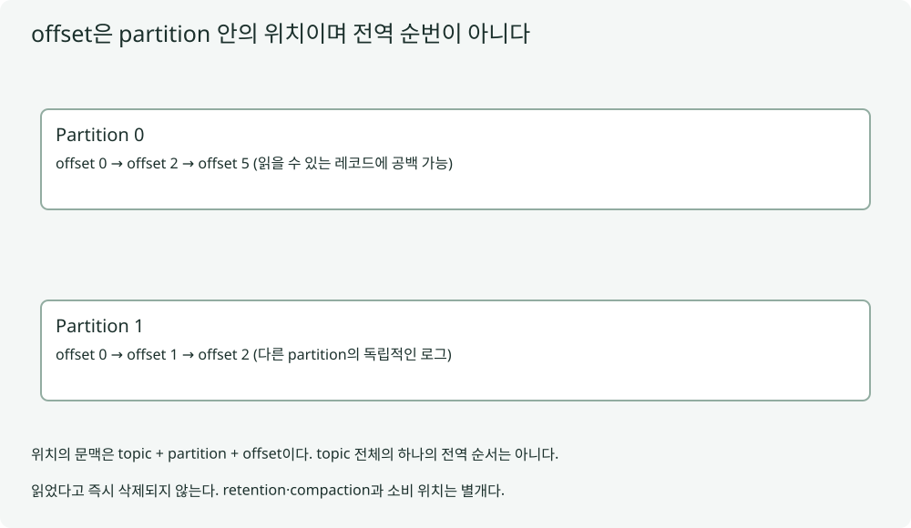

# Kafka 파티션과 로그

## 정의

Kafka topic은 여러 partition으로 나뉘고 각 partition은 순서가 있는 로그입니다. offset은 partition 안의 위치이며 topic 전체의 전역 순번은 아닙니다.

## 설명

그림에서 서로 다른 partition에 같은 offset이 있어도 다른 레코드라는 점을 확인하세요. 위치에는 topic과 partition의 문맥이 필요합니다. offset에는 공백이 있을 수 있고 소비를 완료해도 일반적인 로그 레코드가 즉시 삭제되는 것은 아닙니다.

producer가 partition을 선택해 보내면 leader가 기록과 복제를 조정합니다. 키 기반 배치는 partition 수·partitioner·직렬화 변화에 영향을 받습니다. partition을 늘리면 키의 이후 배치가 바뀔 수 있어 필요한 업무 순서의 범위를 먼저 정합니다.

retention과 compaction은 보존 정책입니다. compaction은 비동기이므로 최신 값 하나만 즉시 남거나 offset이 다시 조밀하게 매겨지는 것은 아닙니다. acks=all도 ISR·min.insync.replicas 같은 확인 조건에 연결되므로 모든 장애의 무손실 보장으로 읽지 않습니다. 보존 기간과 hot partition, 복구 가능한 지연 범위를 관찰합니다.



## 적용 예시

offset 공백이 있는 로그에서 seek 이후의 위치와 다른 partition의 같은 offset을 모델링합니다. 실제 broker·복제·compaction·내구성을 검사하는 코드는 아닙니다.

```java
import java.util.*;
public class KafkaOffsetModelDemo {
  record Record(long offset,String key,String value){}
  static List<Record> seek(List<Record> log,long next){return log.stream().filter(r->r.offset>=next).toList();}
  public static void main(String[] args){
    var retained=List.of(new Record(0,"a","old"),new Record(2,"b","value"),new Record(5,"a","new"));
    assert seek(retained,1).get(0).offset==2;
    assert seek(retained,6).isEmpty();
    var partitionB=List.of(new Record(0,"c","other"));
    assert retained.get(0).offset==partitionB.get(0).offset;
  }
}
```

JDK 17에서 offset 공백·seek 이후 위치·서로 다른 partition의 같은 offset을 모델링합니다. Kafka broker·복제·실제 compaction·acks 내구성은 실행하지 않습니다.

## 정리

Kafka의 순서와 위치는 partition 범위에서 의미가 있습니다. 소비 완료와 로그 삭제는 별개이고 offset에 공백이 생길 수 있습니다. 키 배치와 partition 수의 변화는 업무 순서에 영향을 줄 수 있습니다. 복제 확인과 보존 정책을 실제 장애·재처리 요구에 맞춰 정해야 합니다.

## 꼬리 질문

### Q1. partition A의 offset 7과 B의 offset 7은 같은 이벤트일까요?

offset은 partition 안에서만 위치를 식별합니다. topic·partition을 포함한 문맥 없이 전역 이벤트 ID로 사용할 수 없습니다.

### Q2. partition을 늘려도 같은 키의 배치는 항상 같을까요?

partitioner와 partition 수에 따라 이후 배치가 달라질 수 있습니다. 키 직렬화와 순서 계약을 함께 검토해야 합니다.

---

**참고 자료**

- [Kafka 4.1 설계](https://kafka.apache.org/41/design/design/)
- [KafkaConsumer 4.1 API](https://kafka.apache.org/41/javadoc/org/apache/kafka/clients/consumer/KafkaConsumer.html)
