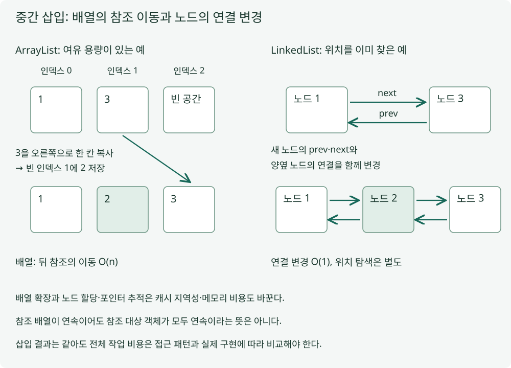

# 배열과 연결 리스트

## 정의

배열 기반 리스트는 인덱스로 원소 위치를 계산하고 연결 리스트는 노드 사이의 링크를 따라 이동합니다. Java의 ArrayList는 참조 배열을, LinkedList는 양방향 노드를 이용합니다.

## 설명

[1,3]의 중간에 2를 넣는다고 해보겠습니다. ArrayList는 인덱스 1에 바로 2를 덮어쓰지 않고 뒤의 3을 오른쪽으로 옮겨 자리를 만든 뒤 저장합니다. 여유 공간이 없다면 더 큰 배열을 준비하는 확장 비용도 듭니다.



그림 왼쪽은 여유 용량이 있는 삽입입니다. 오른쪽에서는 양옆 노드를 이미 찾았다고 가정하고, 새 노드의 prev·next와 양옆 노드의 연결을 바꿉니다. 이 **연결 변경은 O(1)**이어도 인덱스로 위치를 찾는 일은 O(n)일 수 있습니다.

ArrayList의 인덱스 조회는 O(1), 중간 삽입은 이동 때문에 O(n)이며 끝 추가는 분할 상환 O(1)입니다. 매번의 최악 비용이 상수라는 뜻은 아닙니다. 참조 배열의 순차 접근과 노드별 할당·포인터 추적은 캐시 지역성과 메모리·GC 비용도 다르게 만듭니다. 참조 배열이 연속이라고 참조한 객체까지 연속은 아니며 이름만으로 우열을 정하지 않습니다.

## 적용 예시

두 구현 모두 중간 삽입 뒤 [1,2,3]인지 확인하고 LinkedList에서는 iterator로 넣은 2를 다시 제거합니다. ArrayListDemo.java로 저장해 `javac ArrayListDemo.java`, `java -ea ArrayListDemo`를 실행합니다.

```java
import java.util.*;
public class ArrayListDemo {
  public static void main(String[] args) {
    List<Integer> array = new ArrayList<>(3); // 이동을 보기 위한 여유 공간
    array.addAll(List.of(1, 3));
    array.add(1, 2);
    assert array.equals(List.of(1, 2, 3));
    List<Integer> linked = new LinkedList<>(List.of(1, 3));
    ListIterator<Integer> cursor = linked.listIterator(1); // 위치 탐색은 별도 비용
    cursor.add(2);
    assert linked.equals(array);
    int previous = cursor.previous();
    assert previous == 2;
    cursor.remove();
    assert linked.equals(List.of(1, 3)) && array.size() == 3;
    System.out.println("array=" + array + ", linkedAfterRemove=" + linked);
  }
}
```

출력은 `array=[1, 2, 3], linkedAfterRemove=[1, 3]`입니다. listIterator(1)로 위치를 찾는 단계와 cursor.add의 연결 변경을 구분하세요. 시간 차이를 측정한 벤치마크는 아닙니다. 초기 용량 3은 공간을 준비한 것이지 생성 직후 원소가 3개라는 뜻은 아니며, 양 끝 작업이 중심이면 ArrayDeque도 검토할 수 있습니다.

## 정리

같은 중간 삽입도 배열은 뒤 원소를 옮기고 연결 리스트는 링크를 바꿉니다. 위치를 이미 아는지와 그 위치를 찾는 비용을 구분해야 합니다. 배열 확장과 노드 할당·캐시 지역성도 실제 비용에 영향을 줍니다. 접근 패턴과 측정 결과로 선택하고 구조 이름만으로 빠르다고 단정하지 않아야 합니다.

## 꼬리 질문

### Q1. ArrayList의 중간에 바로 새 값을 덮어쓰면 왜 삽입이 아닐까요?

기존 원소를 잃고 크기도 늘지 않을 수 있습니다. 삽입하려면 뒤 원소의 자리를 보존하며 이동해야 합니다.

### Q2. 연결 리스트 중간 삽입이 O(1)이라는 말에는 어떤 전제가 있을까요?

삽입 위치의 노드나 iterator를 이미 확보한 연결 변경의 비용입니다. 인덱스에서 그 위치까지 찾는 비용은 따로 포함해야 합니다.

### Q3. 중간 삽입이 있으니 LinkedList로 바꾸면 항상 빨라질까요?

위치 탐색·순회·노드 할당과 캐시 지역성 비용이 함께 달라집니다. 실제 작업 비율과 데이터 크기를 기준으로 측정해야 합니다.

---

**참고 자료**

- [Java 17 ArrayList](https://docs.oracle.com/en/java/javase/17/docs/api/java.base/java/util/ArrayList.html)
- [Java 17 LinkedList](https://docs.oracle.com/en/java/javase/17/docs/api/java.base/java/util/LinkedList.html)
