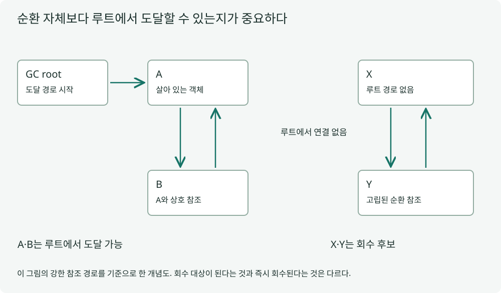

# GC와 객체 도달 가능성

## 정의

GC는 프로그램이 더 이상 사용할 수 없는 객체의 저장 공간을 회수하는 기능입니다. 객체가 살아 있는지는 단순 참조 개수보다 GC Root에서 이어지는 참조 경로로 판단합니다.

## 설명

GC Root는 도달 가능성 추적의 출발점입니다. 실행 중 스레드의 살아 있는 참조나 JVM이 유지하는 참조 등이 출발점이 되며, 살아 있는 클래스의 static 필드를 통해서도 객체에 도달할 수 있습니다. 루트에서 강한 참조를 따라 닿는 객체는 필요한 객체로 추적됩니다.



그림의 A·B와 X·Y는 모두 서로 참조합니다. 차이는 루트에서 이어진 경로입니다. X·Y처럼 서로의 참조가 남아도 루트에서 둘 모두에 닿지 못하면 회수 후보가 될 수 있습니다. 반대로 static 캐시가 필요 없는 객체를 계속 붙잡으면 GC가 있어도 남을 수 있습니다.

참조를 끊는 일과 실제 회수는 다릅니다. 수집기가 언제 어떤 영역을 처리하고 공간을 재사용할지는 정책·상태에 따라 달라지며 System.gc도 특정 객체의 즉시 수거를 보장하지 않습니다. 파일·연결의 종료는 GC 시점에 맡기지 말고 명시적으로 관리합니다.

## 적용 예시

아래는 루트에서 강한 간선을 따라가는 **교육용 그래프 모형**입니다. ReachabilityDemo.java로 저장하고 `javac ReachabilityDemo.java`, `java -ea ReachabilityDemo`로 실행합니다.

```java
import java.util.*;
public class ReachabilityDemo {
  static Set<String> trace(Map<String, List<String>> graph, List<String> roots) {
    Set<String> seen = new TreeSet<>();
    Deque<String> pending = new ArrayDeque<>(roots);
    while (!pending.isEmpty()) {
      String node = pending.removeFirst();
      if (seen.add(node)) pending.addAll(graph.getOrDefault(node, List.of()));
    }
    return seen;
  }
  public static void main(String[] args) {
    var graph = Map.of("A", List.of("B"), "B", List.of("A"),
                       "X", List.of("Y"), "Y", List.of("X"));
    var before = trace(graph, List.of("A"));
    var after = trace(graph, List.of());
    assert before.equals(Set.of("A", "B")) && after.isEmpty();
    System.out.println("before=" + before + ", after=" + after);
  }
}
```

출력은 `before=[A, B], after=[]`입니다. 루트 목록이 A를 포함할 때는 A·B만 추적되고 루트가 비면 순환만으로 생존하지 못하는 모형입니다. JVM의 실제 루트를 나열하거나 객체 회수 시각을 측정한 코드는 아닙니다. 실제 GC 관찰과 이 논리 추적을 구분하며 WeakReference.clear를 수거 증거로 사용하지 않습니다.

## 정리

GC는 루트에서 도달할 수 있는 객체를 추적해 생존 여부를 판단합니다. 서로 참조하는 순환도 루트와 끊기면 회수 후보가 될 수 있습니다. 후보가 됐다는 사실과 실제 공간 회수 시점은 다릅니다. 필요 없는 참조의 보존 경로와 명시적인 자원 종료를 함께 관리해야 합니다.

## 꼬리 질문

### Q1. 객체 두 개가 서로 참조하면 반드시 계속 살아 있을까요?

그 순환에 루트에서 도달하는 경로가 있는지가 중요합니다. 강한 루트 경로가 없다면 순환만 남아도 회수 후보가 될 수 있습니다.

### Q2. 지역 참조를 null로 바꿨는데 메모리가 그대로면 GC 오류일까요?

다른 보존 경로가 남거나 아직 해당 공간을 회수하지 않았을 수 있습니다. 참조 제거를 즉시 메모리 반환 명령으로 해석하면 안 됩니다.

### Q3. 필요 없는 값이 static 캐시에 남으면 GC가 알아서 지울까요?

루트에서 닿는 참조를 유지하면 더 이상 업무에 필요 없어도 생존할 수 있습니다. 캐시의 수명·제거 정책과 실제 보존 경로를 확인해야 합니다.

---

**참고 자료**

- [JLS 17 실행·초기화](https://docs.oracle.com/javase/specs/jls/se17/html/jls-12.html)
- [Java 17 GC 구현](https://docs.oracle.com/en/java/javase/17/gctuning/garbage-collector-implementation.html)
