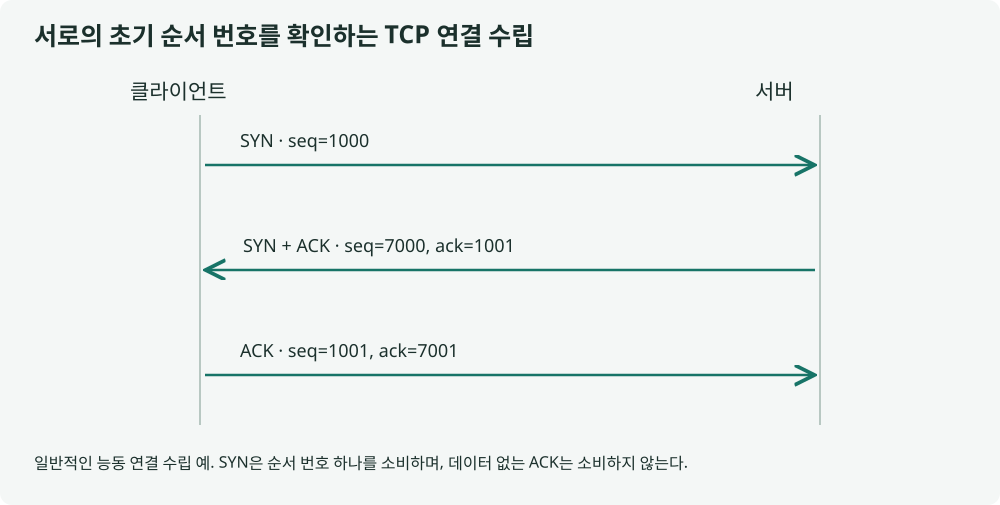

# TCP 연결 수립과 종료

## 정의

TCP 연결 수립은 양쪽이 초기 순서 번호와 연결 상태를 맞추는 과정입니다. 종료는 양방향 통신의 송신 방향을 각각 닫는 과정이므로 수립 절차를 단순히 거꾸로 반복하는 일은 아닙니다.

## 설명

일반적인 수립은 SYN → SYN+ACK → ACK로 진행합니다. 그림에서 상대의 시작 순서 번호에 1을 더해 확인하는 두 방향의 ACK를 보세요. SYN과 FIN은 순서 번호 한 칸을 사용하지만 데이터 없는 ACK 자체는 한 칸을 소비하지 않습니다.

정상 종료에서 한쪽 FIN은 그쪽의 송신 종료를 알립니다. 상대 송신은 별도로 종료하며 FIN과 ACK가 합쳐지거나 RST가 쓰이는 등 경로가 달라져 항상 네 패킷이라고 단정할 수 없습니다.

TIME_WAIT은 정상 종료 뒤 오래된 세그먼트와 마지막 ACK 재전송 등을 다루는 보호 상태입니다. CLOSE_WAIT은 상대 FIN을 받은 뒤 로컬 애플리케이션의 종료가 남은 상황과 관련됩니다. TCP 종료와 상대의 DB 업무 완료는 별개입니다.



## 적용 예시

정상 수립·종료에서 순서 번호와 확인 번호를 계산합니다. 실제 재전송과 순서 번호의 순환 등은 생략한 작은 모델입니다.

```python
# 순서 번호 계산만 보여주는 모형. TCP 구현이나 패킷 캡처가 아닙니다.
x, y = 1000, 7000
syn_ack = {"seq": y, "ack": x + 1}
last_ack = {"seq": x + 1, "ack": y + 1}
assert syn_ack["ack"] == 1001
assert last_ack == {"seq": 1001, "ack": 7001}
sent_bytes = 30
fin_seq = last_ack["seq"] + sent_bytes
assert fin_seq + 1 == 1032  # FIN 확인 시 기대 ACK
```

실제 순서 번호는 유한한 공간에서 순환하며 재전송·옵션 등의 처리가 추가됩니다. 예제는 작은 범위의 정상 흐름 계산에 한정합니다.

## 정리

TCP는 양쪽 연결 상태와 시작 순서를 확인한 뒤 데이터를 주고받습니다. 종료는 송신 방향마다 처리하므로 패킷 수만 외우기보다 상태의 의미를 이해해야 합니다. 연결 성공이나 종료가 애플리케이션 업무의 완료를 뜻하지는 않습니다. 연결을 자주 만들고 닫는다면 재사용과 실제 자원 압박을 함께 봐야 합니다.

## 꼬리 질문

### Q1. 한쪽이 FIN을 보내면 반대쪽도 더 이상 보낼 수 없을까요?

FIN은 보낸 쪽의 정상 송신 종료를 뜻합니다. 반대 방향은 그쪽의 종료가 처리될 때까지 남을 수 있습니다.

### Q2. CLOSE_WAIT이 계속 쌓이면 무엇을 확인할까요?

상대 종료를 받은 뒤 로컬에서 소켓이나 응답 본문을 닫지 않는 경로를 살펴봅니다. TIME_WAIT을 줄이는 설정과 같은 문제로 취급하면 안 됩니다.

---

**참고 자료**

- [RFC 9293: TCP state machine and connection management](https://www.rfc-editor.org/rfc/rfc9293.html)
- [Linux man-pages: tcp(7)](https://man7.org/linux/man-pages/man7/tcp.7.html)
