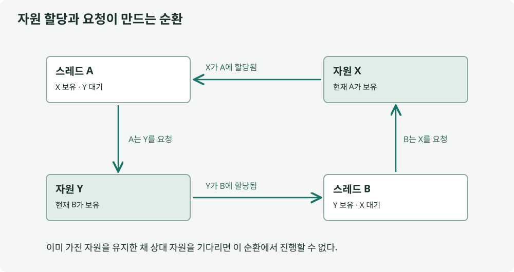


## 정의

교착 상태는 여러 실행 흐름이 서로가 가진 자원을 기다리느라 모두 진행하지 못하는 상태입니다. 잠시 기다렸다 풀리는 일반적인 대기와는 다릅니다.

## 설명

A가 락 X를 잡고 Y를 기다리는 동안 B가 Y를 잡고 X를 기다리면 서로 풀어 줄 기회가 없습니다. 그림에서 두 실행의 보유 자원과 기다리는 화살표가 고리를 만드는 지점을 보세요.

교착 상태의 대표적 필요 조건은 상호 배제·점유 대기·비선점·순환 대기입니다. 조건 하나가 있다는 이유만으로 교착이라고 결론 내리지 말고 실제 점유와 대기를 확인해야 합니다.

모든 경로가 X 다음 Y처럼 같은 순서로 락을 얻으면 순환 대기를 막을 수 있습니다. 타임아웃으로 빠져나올 때에도 이미 바꾼 데이터와 획득한 자원을 안전하게 되돌려야 합니다. 단순 취소가 데이터 복구까지 해 주지는 않습니다.



## 적용 예시

두 자원을 함께 잠그는 작업에서 획득 순서를 통일하는 기존 Java 예제입니다. 송금처럼 여러 대상을 잠글 때는 계좌 ID 같은 전역 순서를 정할 수 있습니다.

```java
public class LockOrderDemo {
    private static final Object FIRST = new Object();
    private static final Object SECOND = new Object();
    private static int value;
    static void update() {
        synchronized (FIRST) {
            synchronized (SECOND) { value++; }
        }
    }
    public static void main(String[] args) throws InterruptedException {
        Thread a = new Thread(LockOrderDemo::update);
        Thread b = new Thread(LockOrderDemo::update);
        a.start(); b.start(); a.join(); b.join();
        if (value != 2) throw new AssertionError(value);
    }
}
```

두 실행 경로 모두 같은 순서로 획득합니다. 테스트는 예제를 실행해 보지만, 한 번의 성공만으로 임의의 프로그램에서 교착 상태가 없음을 증명하지는 않습니다.

## 정리

교착 상태는 서로의 자원을 기다리는 관계 때문에 진행이 멈춘 상황입니다. 락을 여러 개 얻는 작업에서는 모든 경로의 획득 순서를 맞추는 것이 중요한 예방책입니다. 대기 시간을 제한하더라도 부분 변경과 자원 반환은 따로 복구해야 합니다. 진단할 때는 같은 시점의 스레드와 DB 대기 관계를 함께 확인합니다.

## 꼬리 질문


<details class="cs-followup">
<summary>Q1. 두 락을 쓰는 메서드 하나만 순서를 바꾸면 충분할까요?</summary>
<div class="cs-followup-answer">
<p>다른 경로가 반대 순서로 획득하면 순환 대기가 남을 수 있습니다. 같은 자원을 다루는 모든 경로에서 전역 순서를 지켜야 합니다.</p>
</div>
</details>

<details class="cs-followup">
<summary>Q2. 타임아웃으로 대기를 끝내면 교착 문제를 모두 해결한 걸까요?</summary>
<div class="cs-followup-answer">
<p>대기에서 빠져나온 것과 업무 상태가 올바른 것은 다릅니다. 이미 수행한 변경의 롤백과 자원 해제, 안전한 재시도까지 필요합니다.</p>
</div>
</details>

---

**참고 자료**

- [OSTEP: Common Concurrency Problems](https://pages.cs.wisc.edu/~remzi/OSTEP/threads-bugs.pdf)
- [Java 17 ThreadMXBean API](https://docs.oracle.com/en/java/javase/17/docs/api/java/lang/management/ThreadMXBean.html)


