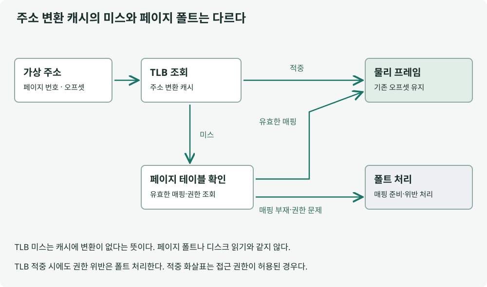


## 정의

페이징은 가상 메모리를 일정 크기의 페이지로 나누어 실제 메모리의 프레임에 연결하는 방식입니다. TLB는 자주 쓰는 주소 변환 정보를 기억해 변환을 빠르게 하는 캐시입니다.

## 설명

가상 주소를 페이지 번호와 페이지 안의 위치인 오프셋으로 나눕니다. 페이지 번호로 프레임을 찾고 오프셋은 그대로 붙여 실제 주소를 구성합니다.

그림의 TLB 적중과 미스 경로를 비교하세요. TLB에 변환이 없더라도 페이지 테이블에 유효한 매핑이 있으면 디스크를 읽지 않고 진행할 수 있습니다. 매핑이나 권한에 문제가 있는 페이지 폴트와 TLB 미스는 다릅니다.

TLB는 데이터 자체가 아니라 주소 변환과 권한 정보를 캐시합니다. 큰 페이지는 적은 항목으로 넓은 범위를 표현할 수 있지만 낭비와 관리 비용도 있어 항상 유리하지는 않습니다. 페이지 크기 역시 모든 환경에서 4KB로 고정된 값은 아닙니다.



## 적용 예시

주소를 페이지 번호와 오프셋으로 나눈 뒤 프레임 번호를 결합합니다. 아래 예제에서 오프셋이 변하지 않는 점을 확인하세요.

```python
page_size = 4096
addresses = [0, 4095, 4096, 8191]
parts = [divmod(address, page_size) for address in addresses]
assert parts == [(0, 0), (0, 4095), (1, 0), (1, 4095)]
# 프레임 9에 매핑한 가상 페이지 1의 마지막 바이트
assert 9 * page_size + parts[-1][1] == 40959
```

오프셋은 주소 변환 후에도 유지됩니다. 예제는 계산 모형이며 TLB 접근 시간을 측정하지 않습니다.

## 정리

페이징은 가상 페이지를 물리 프레임에 연결해 메모리를 배치합니다. TLB는 그 변환을 재사용하여 주소를 찾는 비용을 줄입니다. TLB 미스는 캐시에 정보가 없다는 뜻이며 곧바로 페이지 폴트나 디스크 접근을 뜻하지 않습니다. 페이지 크기와 접근 패턴은 변환 비용과 메모리 낭비를 함께 고려해 선택합니다.

## 꼬리 질문


<details class="cs-followup">
<summary>Q1. TLB에 변환이 없는데도 디스크를 읽지 않을 수 있을까요?</summary>
<div class="cs-followup-answer">
<p>가능합니다. 페이지 테이블에서 유효한 RAM 매핑을 찾으면 그 변환으로 접근할 수 있습니다.</p>
</div>
</details>

<details class="cs-followup">
<summary>Q2. 페이지 크기를 키우면 항상 빨라질까요?</summary>
<div class="cs-followup-answer">
<p>더 넓은 범위를 적은 변환으로 표현할 수는 있습니다. 하지만 내부 단편화와 할당·관리 제약이 있어 실제 부하에서 비교해야 합니다.</p>
</div>
</details>

---

**참고 자료**

- [OSTEP: Paging — Introduction](https://pages.cs.wisc.edu/~remzi/OSTEP/vm-paging.pdf)
- [OSTEP: Faster Translations — TLBs](https://pages.cs.wisc.edu/~remzi/OSTEP/vm-tlbs.pdf)


