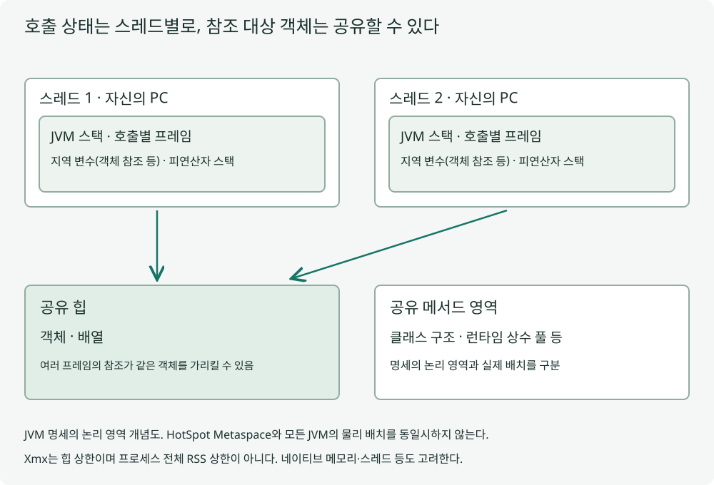


## 정의

JVM은 실행에 필요한 메모리를 스레드별 영역과 함께 쓰는 영역으로 구분합니다. 메서드의 실행 상태를 담는 스택과 객체를 다루는 힙은 역할이 다릅니다.

## 설명

메서드를 호출하면 지역 변수와 중간 계산을 담는 프레임이 스택에 생기고 반환하면 제거됩니다. 지역 참조가 힙 객체를 가리킬 수 있으므로 메서드가 끝나도 다른 참조가 남으면 그 객체는 유지됩니다. 그림의 스레드별 스택에서 같은 힙으로 향하는 관계를 확인하세요.

JVM 명세의 PC·스택·힙·메서드 영역은 논리적 구분입니다. HotSpot의 Metaspace나 JIT의 할당 최적화를 모든 JVM의 고정 물리 배치처럼 설명하면 안 됩니다. 모든 지역 객체가 스택에 할당된다는 뜻도 아닙니다.

Xmx는 힙의 상한이며 프로세스 전체 메모리 상한이 아닙니다. 스택·직접 버퍼·네이티브·클래스 메타데이터도 사용하므로 힙 덤프만으로 모든 메모리 문제를 찾을 수 없습니다.



## 적용 예시

반환 뒤에도 공유 참조가 객체를 유지하는지와 힙 관리 지표를 확인합니다. 실제 객체 주소·스택 할당이나 GC 시점을 증명하는 예제는 아닙니다.

```java
import java.lang.management.*;
public class JvmMemoryDemo {
  static Object keep;
  static void allocate(){Object local=new byte[1024];keep=local;}
  public static void main(String[] args){
    allocate();assert keep instanceof byte[];
    MemoryUsage heap=ManagementFactory.getMemoryMXBean().getHeapMemoryUsage();
    assert heap.getUsed()>=0 && heap.getCommitted()>=heap.getUsed();
    keep=null;
    System.out.println("heap used="+heap.getUsed());
  }
}
```

JDK 17에서 반환 후 공유 참조가 객체를 유지하고 힙 관리 지표를 읽을 수 있는지 확인합니다. 객체 주소·스택 배치나 GC 시점을 증명하는 실험은 아닙니다.

## 정리

JVM 메모리는 실행 상태와 공유 객체 등 서로 다른 역할로 나뉩니다. 지역 참조의 수명과 그 객체의 수명은 같지 않습니다. 명세의 논리 영역과 구현의 실제 배치도 구분해야 합니다. 메모리 한도 문제에서는 힙뿐 아니라 스택·네이티브 사용량을 함께 봅니다.

## 꼬리 질문


<details class="cs-followup">
<summary>Q1. 메서드가 반환하면 안에서 만든 객체도 반드시 사라질까요?</summary>
<div class="cs-followup-answer">
<p>다른 곳이 그 객체를 참조한다면 남을 수 있습니다. 제거되는 스택 프레임과 참조 대상 객체의 생존은 구분해야 합니다.</p>
</div>
</details>

<details class="cs-followup">
<summary>Q2. Xmx를 늘리면 재귀의 스택 초과도 해결될까요?</summary>
<div class="cs-followup-answer">
<p>힙 상한과 스레드 스택은 다른 자원입니다. 재귀 깊이와 스택 사용을 별도로 확인해야 합니다.</p>
</div>
</details>

---

**참고 자료**

- [JVMS 17 런타임 영역](https://docs.oracle.com/javase/specs/jvms/se17/html/jvms-2.html)
- [JLS 17 실행·초기화](https://docs.oracle.com/javase/specs/jls/se17/html/jls-12.html)


