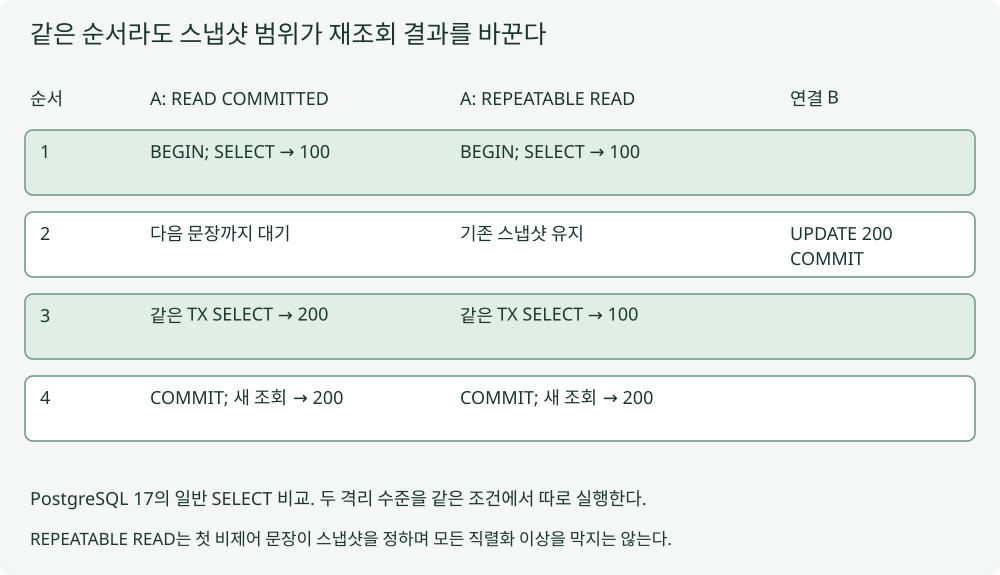


## 정의

트랜잭션 격리 수준은 동시에 실행되는 작업이 서로의 변경을 언제 보고 어떤 충돌을 허용할지 정하는 규칙입니다. 같은 격리 이름도 DB 구현에 따라 보장 범위가 다를 수 있습니다.

## 설명

PostgreSQL 17의 일반 SELECT에서 READ COMMITTED는 **문장마다 새 스냅샷**을 얻습니다. 같은 트랜잭션 안의 두 SELECT 사이에 B가 커밋하면 두 번째 조회가 새 값을 볼 수 있습니다. REPEATABLE READ는 첫 비제어 문장 시점의 스냅샷을 유지하므로 B의 커밋 뒤에도 같은 모습을 볼 수 있습니다.



그림의 동일 실행 순서를 두 격리 수준에 적용해 보세요. REPEATABLE READ도 BEGIN만으로 언제나 스냅샷이 고정되는 것은 아니며 이 실습의 첫 SELECT가 기준입니다. A가 종료하고 새 문장으로 조회하면 200을 볼 수 있습니다.

SQL 표준의 최소 조건과 PostgreSQL 구현은 다릅니다. PostgreSQL의 REPEATABLE READ는 일반 조회의 팬텀도 막지만 모든 직렬화 이상을 없애지는 않습니다. 여러 행의 업무 조건에는 적절한 제약·잠금·SERIALIZABLE 등을 검토하고 직렬화 실패는 전체 트랜잭션의 재시도 경계로 다룹니다.

## 적용 예시

같은 실습 DB에 연결 A·B를 열고 아래 블록을 **위에서 아래로 한 블록씩**, 표시한 연결에서 실행합니다. B는 psql 기본 auto-commit이 켜진 상태입니다.

| A의 순서 | B가 200을 커밋하기 전 | 커밋 뒤 같은 TX에서 재조회 | A 종료 뒤 새 조회 |
| --- | --- | --- | --- |
| READ COMMITTED | 100 | 200 | 200 |
| REPEATABLE READ | 100 | 100 | 200 |

```sql
-- session: setup
CREATE TABLE balance_demo (id integer PRIMARY KEY, amount integer NOT NULL);
INSERT INTO balance_demo VALUES (1, 100);
```

```sql
-- session: A
BEGIN ISOLATION LEVEL READ COMMITTED;
SELECT amount FROM balance_demo WHERE id = 1; -- 100
```

```sql
-- session: B
UPDATE balance_demo SET amount = 200 WHERE id = 1; -- auto-commit
```

```sql
-- session: A
SELECT amount FROM balance_demo WHERE id = 1; -- 200
DO $$ BEGIN ASSERT (SELECT amount FROM balance_demo WHERE id=1)=200; END $$;
COMMIT;
```

```sql
-- session: setup
UPDATE balance_demo SET amount = 100 WHERE id = 1;
```

```sql
-- session: A
BEGIN ISOLATION LEVEL REPEATABLE READ;
SELECT amount FROM balance_demo WHERE id = 1; -- 100: 스냅샷 확정
```

```sql
-- session: B
UPDATE balance_demo SET amount = 200 WHERE id = 1; -- auto-commit
```

```sql
-- session: A
SELECT amount FROM balance_demo WHERE id = 1; -- 같은 스냅샷: 100
DO $$ BEGIN ASSERT (SELECT amount FROM balance_demo WHERE id=1)=100; END $$;
COMMIT;
SELECT amount FROM balance_demo WHERE id = 1; -- 새 조회: 200
DO $$ BEGIN ASSERT (SELECT amount FROM balance_demo WHERE id=1)=200; END $$;
```

중간 setup의 UPDATE는 두 실험을 같은 값 100에서 시작하게 합니다. 실제 출력은 차례로 100, 200, 100, 100, 200이며 DO의 ASSERT도 결과를 검사합니다. 일반 SELECT 스냅샷 비교이며 잠금 경쟁·write skew·다른 DB 전체의 격리 동작을 검증하지는 않습니다.

## 정리

격리 수준은 같은 데이터를 다시 읽을 때 어떤 모습을 보는지에 영향을 줍니다. PostgreSQL의 READ COMMITTED는 문장별, REPEATABLE READ는 트랜잭션 스냅샷을 사용합니다. 표준 이름과 실제 구현의 추가 보장을 구분해야 합니다. 반복 조회의 안정성과 여러 행의 업무 정합성도 같은 문제는 아닙니다.

## 꼬리 질문


<details class="cs-followup">
<summary>Q1. B의 커밋 뒤 A가 100을 읽으면 B의 저장이 실패한 걸까요?</summary>
<div class="cs-followup-answer">
<p>A가 기존 스냅샷을 유지하는 격리 수준일 수 있습니다. B의 커밋 결과와 A가 관찰하는 시점을 구분해야 합니다.</p>
</div>
</details>

<details class="cs-followup">
<summary>Q2. REPEATABLE READ의 BEGIN 직후부터 항상 같은 스냅샷일까요?</summary>
<div class="cs-followup-answer">
<p>PostgreSQL에서는 첫 비제어 문장 시점이 기준입니다. 이 실습에서는 첫 SELECT가 그 스냅샷을 정합니다.</p>
</div>
</details>

<details class="cs-followup">
<summary>Q3. 같은 SELECT 결과가 고정되면 모든 업무 경쟁도 해결될까요?</summary>
<div class="cs-followup-answer">
<p>여러 행의 불변식이나 직렬화 이상은 남을 수 있습니다. 필요한 제약·잠금과 실패 후 전체 재시도를 별도로 설계해야 합니다.</p>
</div>
</details>

---

**참고 자료**

- [PostgreSQL 17: Transaction Isolation](https://www.postgresql.org/docs/17/transaction-iso.html)
- [PostgreSQL 17: Explicit Locking](https://www.postgresql.org/docs/17/explicit-locking.html)


