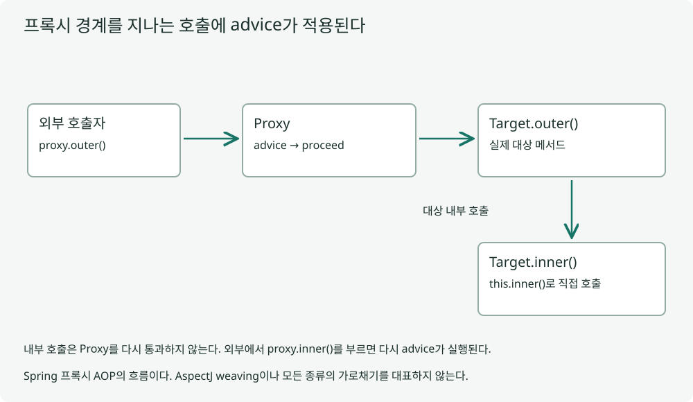


## 정의

AOP는 로깅이나 트랜잭션처럼 여러 기능에 공통으로 필요한 처리를 분리하는 방법입니다. Spring의 프록시 AOP는 대상 객체 앞의 프록시를 거치는 메서드 호출에 공통 처리를 적용합니다.

## 설명

호출자는 프록시에 요청하고 프록시는 적용할 처리인 advice를 실행한 뒤 실제 메서드를 호출합니다. pointcut은 어떤 메서드 실행을 선택할지 정합니다. 그림에서 외부 호출은 프록시를 지나지만 대상 내부의 this.inner 호출은 프록시로 돌아가지 않는다는 점을 보세요.

이 차이 때문에 같은 클래스 안의 자기 호출에는 기대한 advice가 실행되지 않을 수 있습니다. 애노테이션이 붙어 있다는 것보다 호출이 어느 객체를 경유하는지가 중요합니다. 책임을 별도 Bean으로 나누면 적용 경계를 더 분명히 만들 수 있습니다.

JDK 프록시는 인터페이스를 구현하고 클래스 기반 프록시는 상속을 이용합니다. 후자는 final 클래스·메서드나 private 메서드 같은 제약을 받습니다. 생성자나 필드 접근까지 모두 가로채는 방식으로 이해하지 말고 AspectJ weaving과 구분합니다.



## 적용 예시

외부에서 프록시를 거쳐 호출할 때와 대상 내부에서 자기 호출할 때 advice 횟수를 비교합니다. 공통 처리가 실제로 실행되는 경계를 숫자로 확인합니다.

```java
package study;
import java.util.concurrent.atomic.AtomicInteger;
import org.aopalliance.intercept.MethodInterceptor;
import org.junit.jupiter.api.Test;
import org.springframework.aop.framework.ProxyFactory;
import static org.junit.jupiter.api.Assertions.*;
public class AopTest {
  interface Work {String outer();String inner();}
  static class Target implements Work {public String outer(){return inner();}public String inner(){return "ok";}}
  @Test void selfInvocationBypassesProxy(){
    var calls=new AtomicInteger();var factory=new ProxyFactory(new Target());
    factory.addAdvice((MethodInterceptor)inv->{calls.incrementAndGet();return inv.proceed();});
    Work proxy=(Work)factory.getProxy();
    assertEquals("ok",proxy.outer());assertEquals(1,calls.get());
    proxy.inner();assertEquals(2,calls.get());
  }
}
```

`examples/spring-lab`(Java 17, Spring Boot 3.5.16)의 JUnit 예제입니다. 외부 서비스나 운영 DB 연결 없이 실행하며 문서와 실제 테스트 소스를 대조합니다. 프록시 외부 호출과 내부 자기 호출의 advice 횟수를 구분합니다.

## 정리

Spring의 프록시 AOP는 호출 경계에 공통 기능을 덧붙입니다. advice의 실행 여부는 애노테이션뿐 아니라 실제 프록시 경유 여부에 달려 있습니다. 자기 호출과 프록시 종류별 제약을 확인해야 합니다. 트랜잭션이나 권한 기능도 실제 외부 호출 경계에서 검사하는 것이 중요합니다.

## 꼬리 질문


<details class="cs-followup">
<summary>Q1. outer 안에서 this.inner를 호출하면 inner의 advice도 실행될까요?</summary>
<div class="cs-followup-answer">
<p>일반적인 프록시 방식에서는 대상 내부 호출이 프록시를 다시 거치지 않습니다. inner에 설정한 처리가 필요하다면 책임과 외부 호출 경계를 재검토해야 합니다.</p>
</div>
</details>

<details class="cs-followup">
<summary>Q2. 클래스 기반 프록시라면 private 메서드도 가로챌까요?</summary>
<div class="cs-followup-answer">
<p>private 메서드는 하위 클래스가 재정의할 수 없어 같은 방식으로 advice를 적용할 수 없습니다. 프록시 AOP의 범위를 weaving과 혼동하지 않아야 합니다.</p>
</div>
</details>

---

**참고 자료**

- [Spring Framework 6.2 공식 문서](https://docs.spring.io/spring-framework/reference/6.2/core/aop/proxying.html)


