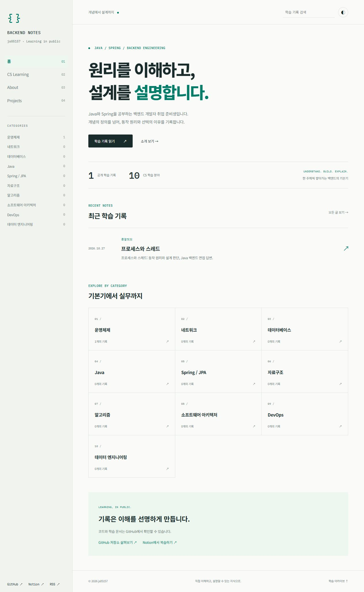
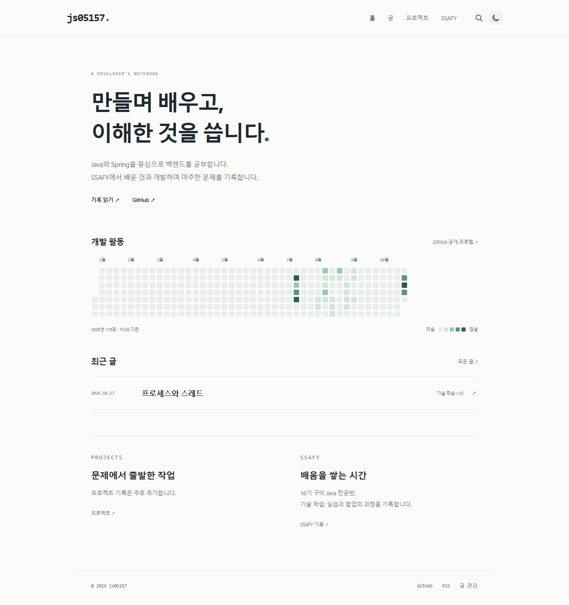
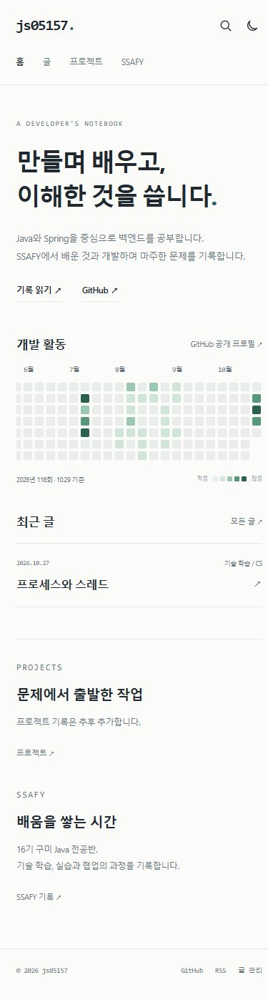
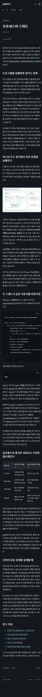

# 개인 개발자 블로그 개편 완료 · 2026-10-29

개인 블로그 화면, 첫 글의 동일 ID 개정, GitHub 글 관리 동선과 비공개 기존 100개 문서의 설명형 편집을 완료했습니다. 실제 공개 글은 첫 문서 한 개입니다. 프로젝트는 사용자 선택대로 추후 추가하도록 비워 두었습니다.

## 실제 주소

- [개편된 홈](https://js05157.github.io/cs-interview/)
- [첫 글: 프로세스와 스레드](https://js05157.github.io/cs-interview/topics/os-process-thread/)
- [GitHub 원문](https://github.com/js05157/cs-interview/blob/master/Operating-System/Process/os-process-thread.md)
- [같은 Notion 페이지](https://www.notion.so/40647f4c2c2581b4b2a3dd1cdeb62644)
- [글 관리](https://js05157.github.io/cs-interview/manage/) / [SSAFY](https://js05157.github.io/cs-interview/ssafy/)

## 화면과 콘텐츠

큰 CS 사이드바·카테고리 카드 대신 소개, 실제 GitHub 공개 활동, 최근 글과 프로젝트·SSAFY 진입으로 홈을 구성했습니다. 메뉴는 홈/글/프로젝트/SSAFY 네 개입니다. 활동 데이터는 출처·기준 날짜가 있는 실제 calendar snapshot이며 실시간 갱신이나 블로그 작성 횟수로 표시하지 않습니다. 방문 시 외부 위젯·외부 웹 폰트를 호출하지 않습니다. 프로젝트 성과나 SSAFY 활동을 만들지 않았습니다. SSAFY 16기 구미 Java 전공반은 사용자 제공 정보입니다.

글 목록에 종류 필터와 검색을 두고 본문은 읽기 폭·접힌 목차·코드 복사·SVG 확대·대체 텍스트·라이트/다크를 지원합니다. `/about/`, `/learning/` 기존 진입점은 새 구조로 연결합니다. RSS·사이트맵·robots·canonical·Open Graph와 `/cs-interview/` 경로를 유지했습니다.

첫 글은 면접 스크립트·30초/1분 답변·핵심 요약을 제거하고 프로그램 실행의 경계 → 공유/분리 메모리 → 실행 코드와 선택 조건으로 설명합니다. 직접 작성한 프로세스·스레드 SVG와 기존 Java 예제를 포함합니다. 원래 게시일 2026-10-27, topic_id, GitHub 경로, permalink와 Notion 페이지 ID를 유지했습니다. Notion 계층은 CS 기술 면접 공부 → 운영체제 → Process → 프로세스와 스레드입니다. 개정 후 본문·코드·표 47개 항목 누락 0개, 최종 재조회에서도 본문과 수정 시각이 같았습니다.

비공개 기존 100개를 맥락에 맞게 편집했습니다. 분야별 OS 10, Network 12, Database 12, Data Structure 8, Algorithm 8, Java 14, Spring/JPA 14, Architecture 10, DevOps 6, Data Engineering 6입니다. 중복·누락 0개이며 ID·순서·카탈로그·대기열·원래 코드·출처를 보존했습니다. 고정 10개 절을 다시 강제하지 않도록 비공개 작성 안내도 바꿨습니다. 직접 작성 SVG 총 26개 중 공개된 것은 첫 글의 하나뿐이며 나머지 99개 본문과 25개 도식은 비공개에만 있습니다.

## 관리 기능과 사용 방법

/manage/에서 Markdown·제목·날짜·태그·글 종류·공개 여부를 입력하고 브라우저 미리보기로 확인합니다. ‘GitHub에서 저장’으로 원고를 준비한 뒤 GitHub 편집기에서 내용을 확인하고 커밋합니다. 긴 원고는 복사 안내/다운로드 후 ‘GitHub 편집기 열기’ 링크로 이동합니다. 원고를 바꾸면 오래된 저장 링크는 숨깁니다. 이미지 업로드, 기존 일반 글 수정·삭제는 GitHub 화면으로 연결합니다. `published: false`는 목록·검색·RSS·사이트맵에서 제외되지만 공개 저장소 소스·기록을 비밀로 만들지는 않습니다.

실제 쓰기·수정·삭제는 GitHub 로그인과 서버의 저장소 권한 검사가 담당합니다. 현재 write/admin 주체는 js05157 한 명입니다. 비로그인 브라우저는 로그인으로 이동했습니다. 자체 계정명 비교·숨겨진 URL을 보안으로 쓰지 않았으며 브라우저 PAT·Actions Secret 전달, 새 인증 서버·OAuth 앱·유료 서비스 연결이 없습니다. 다른 계정으로 로그인해 쓰기를 시도하지는 않았습니다.

일반 글에는 topic_id를 넣지 않고 CS 큐·Notion 동기화와 분리합니다. CS 개정·공개 중단은 [전용 운영 절차](../CONTENT_MANAGEMENT.md)를 사용합니다. 공개 중단은 tombstone을 남겨 자동 재생성을 차단하고 Notion 페이지를 자동 삭제하지 않습니다. 실제 첫 글 삭제·공개 중단은 실행하지 않았으며 관련 계약은 mock으로 검증했습니다.

## 실제 검증

| 항목 | 결과·범위 |
|---|---|
| Python | 65개 통과. 중복·개정·응답 유실·수동 편집 보호·tombstone·자산 범위·배포 영수증 포함 |
| 콘텐츠 | 구조·기존 코드/출처·ID·카탈로그/큐 보존·Notion 오프라인 변환 100/100 |
| 독립 예제 | Java 63개, Python 6개 재실행 통과 |
| Spring | JUnit 14개 통과, 문서와 테스트 소스 14/14 일치. H2/MockMvc 범위 |
| DB | PostgreSQL 17.11에서 SQL 22개 통과. 외부 포트·네트워크 없는 임시 DB 정리 |
| 컨테이너·설정 | 정확한 Docker 예제 실제 빌드·비루트 실행 성공. YAML 3개 정적 검사 |
| 참고 링크 | 고유 HTTPS 143개 응답 확인. 응답 성공이 모든 기술 주장의 증명은 아님 |
| Jekyll | 로컬 공식 Jekyll 3.10 컨테이너와 실제 Actions 빌드 성공. HTML 10개/공개 글 1개 |
| 일반 글 fixture | 로컬 HTML 14개/종류 5개, SSAFY 분류·비노출 초안 제외·일반 글 첫 H1 표시 성공. fixture는 게시하지 않음 |
| 실제 사이트 | 17개 경로·정적 자산 HTTP 200, 검색 글 1개, baseurl·RSS·SEO 검사 통과 |
| 브라우저 | 데스크톱/390px, 모바일 가로 넘침 없음, 메뉴·검색·종류 필터·테마·달력 방향키·도식 로딩/확대·코드 복사 피드백 확인 |
| 상태·중복 | 첫 ID/날짜/URL/페이지 유지, 세 플랫폼 complete, 배포 digest 일치. 동일 날짜 daily-limit·다음 날짜 신규 후보 승인 정책 차단. 읽기 전용 대조 중 공개 추적 파일 무변경 |

- [최종 코드 CI 성공](https://github.com/js05157/cs-interview/actions/runs/40794444371): commit 3f5073c, Python·Jekyll·사이트 검사.
- [최종 콘텐츠 Actions dry-run 성공](https://github.com/js05157/cs-interview/actions/runs/40794444611): CONTENT_REPO_TOKEN 존재/비공개 읽기, 문서 100개, 중복/복구 mock, 공개 추적 파일 무변경. 게시·배포 job skipped.
- [최종 사이트 전용 배포 성공](https://github.com/js05157/cs-interview/actions/runs/40794566012): site-update/topic 없음, Notion skipped, build/deploy/record 성공.
- [기존 첫 글 개정·복구 성공](https://github.com/js05157/cs-interview/actions/runs/40788565240): 동일 Notion 페이지·원래 날짜/URL 유지.
- [예약 게이트 비활성 확인](https://github.com/js05157/cs-interview/actions/runs/40835715796): gate만 실행, publish/build/deploy/record skipped.

기계 검증은 [FINAL_VERIFICATION.json](FINAL_VERIFICATION.json), 콘텐츠 상세 실행 근거는 비공개 저장소의 docs/EDITORIAL_COMPLETION.md/JSON과 배치 보고서에 보관했습니다. 워크플로우 2개는 기존 원격 파일과 일치하며 이번 최종 변경에서 수정하지 않았습니다.

## 유지한 승인 범위와 남은 설정

CS_AUTO_PUBLISH는 미설정이고 publication_policy는 첫 topic 하나만 허용합니다. 기존 첫 글 상태·Notion 구조를 유지했으며 추가 CS 공개·새 Notion 페이지·예약 활성화는 하지 않았습니다. 별도 사용자 승인 전에는 이 경계를 확대하지 않습니다. CONTENT_REPO_TOKEN 읽기 전용 권한은 바꾸거나 다른 용도로 쓰지 않았습니다. OpenAI/LLM API는 사용하지 않았습니다.

현재 블로그 이용에 새 외부 인증 서비스나 추가 Secret 설정은 필요하지 않습니다. 실제 글 저장에는 본인의 GitHub 로그인이 필요하고 저장소에 다른 쓰기 협업자를 추가하지 않아야 소유자만 관리하는 구성이 유지됩니다. 프로젝트 내용·SSAFY 글은 사용자가 작성할 때 추가합니다. 활동 snapshot은 필요할 때 수동 갱신합니다.

향후 자동 게시 승인 전에는 허용 ID 범위·토큰 만료·Notion 부모 연결/용량·부분 실패 복구·현재 배포 상태와 예약 정책을 다시 확인합니다. 기존 개발 인증에는 workflow scope가 없어 향후 워크플로우 수정이 필요하면 기존 웹 등록 절차를 사용합니다.

관리 기능은 GitHub 편집 동선을 가진 정적 작성 도구이며 완전한 자체 CMS가 아닙니다. 클립보드 성공 피드백은 확인했지만 클립보드 바이트를 별도 검증하지 않았습니다. H2/MockMvc·인메모리 Kafka/Flink/CDC 모델·정적 Kubernetes 검사를 운영 서비스의 성능·장애 전환·실제 비밀번호 로그인 보장으로 보고하지 않습니다.

## 화면 증거

개편 전 홈:

개편 후 홈:

